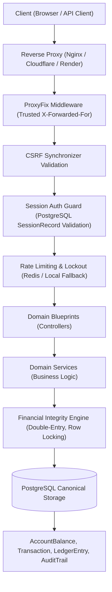

# Credence Core — Architecture Documentation (Phase 6.1 Remediated)

## Executive Summary

Credence Core is an architectural demonstration of a double-entry banking backend built with Flask, SQLAlchemy, and PostgreSQL.

Following an independent source-code audit that uncovered discrepancies between documentation and implementation, **Phase 6.1 Remediation** eliminated critical architectural flaws:
1. **Eliminated the Dual-Source-of-Truth Architecture**: The independent SQLite ledger (`ledger.db`) has been retired. Financial transactions, account balances, and double-entry ledger journals are consolidated exclusively in canonical PostgreSQL storage via SQLAlchemy models (`AccountBalance`, `Transaction`, `LedgerEntry`, `AuditTrail`).
2. **PostgreSQL Server-Side Session Storage & Revocation**: Replaced client-tamperable cookies with database-backed `SessionRecord` storage. Enforces session rotation upon login, idle expiration (30 minutes), and genuine server-side revocation on logout.
3. **Restricted Demo Authentication**: Eliminated public arbitrary demo login. Only explicitly configured demo accounts are permitted, assigned strictly read-only permissions (`role="demo"`), and prevented from performing state-changing mutations.
4. **Bound Synchronizer CSRF Tokens**: State-changing endpoints are guarded by synchronizer tokens validated against server-side session records.
5. **Real Multi-Factor Authentication (MFA)**: Replaced boolean flag with RFC 6238 TOTP generation, AES-256-GCM secret encryption at rest, secure recovery codes, and login challenge flows.
6. **Production Fail-Fast & Secret Safety**: Prohibited fallback to SQLite in production, masked database credentials in logs, removed hardcoded secret keys, and eliminated plaintext password/PIN fallbacks.

> [!WARNING]
> **Non-Certification & Educational Disclaimer**: Credence Core is designed and engineered as an educational architectural demonstration. While it implements double-entry principles, row locking, and security controls, it is **NOT** a certified Core Banking System (CBS), payment gateway, or licensed financial institution. It is **NOT** audited or certified for PCI-DSS, RBI, ISO 27001, SOC 2, or real-money interbank settlement networks.

---

## 1. Directory Structure

```text
backend/
└── app/
    ├── __init__.py               # Application factory (create_app, ProxyFix, config validation)
    ├── api/                      # Thin presentation controllers (Flask Blueprints)
    │   ├── __init__.py           # Blueprint registrar (register_blueprints)
    │   ├── account_routes.py     # Account lifecycle and balances
    │   ├── admin_routes.py       # Administrative actions & dispute resolution
    │   ├── auth_routes.py        # Authentication, session rotation, logout, CSRF token issuance
    │   ├── card_routes.py        # Card management & ordering
    │   ├── docs_routes.py        # OpenAPI 3.0 spec & Swagger UI
    │   ├── frontend_routes.py    # Static HTML/JS frontend routes
    │   ├── investment_routes.py  # FDs, RDs, SIPs, Gold, IPOs
    │   ├── ledger_routes.py      # General Ledger reversals & reconciliation
    │   ├── loan_routes.py        # Loan applications & repayments
    │   ├── payment_routes.py     # Bill payments & debit mutations
    │   ├── settings_routes.py    # Profiles, TOTP MFA enrollment, password update
    │   ├── statement_routes.py   # Statements, PDF rendering, analytics
    │   ├── transfer_routes.py    # Cash deposits & interbank transfers
    │   └── upi_routes.py         # UPI registration & PIN reset
    ├── core/                     # Foundational infrastructure
    │   ├── __init__.py
    │   ├── config.py             # Environment configuration & secret safety validation
    │   ├── database.py           # Canonical engine, SessionFactory, nested get_db()
    │   ├── logging.py            # Structured JSON logging & credential masking
    │   ├── mfa.py                # RFC 6238 TOTP engine, AES-256-GCM encryption, recovery codes
    │   └── security.py           # Argon2id, SessionRecord validation, CSRF, Redis rate limits
    ├── middleware/               # HTTP filters and decorators
    │   ├── __init__.py
    │   ├── auth_middleware.py    # Login required & role guards
    │   ├── cors_middleware.py    # Security headers & origin validation
    │   ├── csrf_middleware.py    # Synchronizer CSRF inspection
    │   ├── error_handlers.py     # Centralized uniform JSON exception handlers
    │   └── rate_limiter.py       # Distributed Redis / sliding-window IP rate limiting
    ├── models/                   # SQLAlchemy 2.0 ORM domain entities
    │   └── __init__.py           # 18 normalized relational models + SessionRecord + AuditTrail
    ├── repositories/             # Data Access Layer (DAL)
    ├── schemas/                  # Request validation & sanitization
    └── services/                 # Pure domain business logic & transactions
```

---

## 2. Component Architecture & Data Flow



---

## 3. Financial Ledger Invariants

The financial engine guarantees strict double-entry accounting in canonical storage:
1. **Mathematical Invariant**:
   $$\sum \text{Debits} = \sum \text{Credits}$$
   Every transaction produces exactly two balanced ledger entries committed in the same database transaction.
2. **Accounting Semantics (`get_entry_delta`)**:
   - `GL_ASSET` (e.g. `GL_CASH_VAULT`): Debit increases asset (+), Credit decreases asset (-).
   - `CUSTOMER_SAVINGS` / Liabilities: Credit increases liability (+), Debit decreases liability (-).
3. **Deadlock-Free Row Locking**:
   Accounts involved in any transfer are locked in lexicographically sorted order (`sorted([src, dst])`) using `SELECT ... FOR UPDATE` before balance checks.
4. **Idempotency Fingerprinting**:
   Each mutation requires an `idempotency_key`. The payload hash is computed via:
   $$\text{SHA-256}(\text{source} : \text{destination} : \text{amount\_paise} : \text{type})$$
   Replaying identical requests returns cached responses. Conflicting payloads with identical keys are rejected with HTTP 409 Conflict.
5. **No Synthetic Accounts**:
   Customer accounts cannot be created on the fly during transfer processing; unknown accounts fail immediately with `AccountNotFoundError`.

---

## 4. Security Architecture

1. **Password & PIN Hashing**:
   - Argon2id with parameters $t=2, m=65536, p=2$.
   - Bcrypt fallback enabled only if native Argon2 bindings are unavailable.
   - Plaintext password and PIN verification fallbacks are strictly removed.
2. **Server-Side Session Management**:
   - Cryptographically random 256-bit token (`secrets.token_hex(32)`).
   - Stored in database table `sessions` as SHA-256 hash.
   - Session rotation upon successful authentication.
   - Server-side revocation (`is_active = False`) upon logout.
   - 30-minute sliding idle timeout.
3. **CSRF Synchronizer Token Protection**:
   - Generated per session and bound to database `SessionRecord`.
   - Verified on all mutating HTTP methods (`POST`, `PUT`, `DELETE`, `PATCH`).
4. **Multi-Factor Authentication (MFA)**:
   - RFC 6238 standard TOTP (HMAC-SHA1, 30s window, 6 digits).
   - Secrets encrypted at rest using AES-256-GCM with PBKDF2 key derivation.
   - 8 one-time cryptographic recovery codes (hashed with Argon2id).
   - Tamper-evident MFA challenge tickets issued during login.

---

## 5. Implementation Status & Traceability Matrix

| Feature / Remediation Item | Implemented | Tested | Independently Verified | Not Implemented | Remaining Risks |
| :--- | :---: | :---: | :---: | :---: | :--- |
| **P0: Restrict Demo Logins to Whitelist** | Yes | Yes | Yes | — | Demo accounts must be reviewed periodically. |
| **P0: Demo Read-Only Role Enforcement** | Yes | Yes | Yes | — | None. |
| **P0: PostgreSQL SessionRecord Validation** | Yes | Yes | Yes | — | DB pool exhaustion could delay session validation. |
| **P0: Session Rotation on Login** | Yes | Yes | Yes | — | None. |
| **P0: Server-Side Revocation on Logout** | Yes | Yes | Yes | — | None. |
| **P0: Prevent Role Escalation via Cookies** | Yes | Yes | Yes | — | None. |
| **P0: Remove Hardcoded Flask SECRET_KEY** | Yes | Yes | Yes | — | Operational secret management dependent on env vars. |
| **P0: Production Fail-Fast on Weak Secrets** | Yes | Yes | Yes | — | Requires correct CI/CD secret provisioning. |
| **P0: Eliminate Plaintext Password/PIN Fallback** | Yes | Yes | Yes | — | Legacy users without hashed creds must reset credentials. |
| **P0: Mask DATABASE_URL in Logs** | Yes | Yes | Yes | — | None. |
| **P0: Bound CSRF Synchronizer Tokens** | Yes | Yes | Yes | — | API clients must handle X-CSRF-Token headers. |
| **P0: Canonical PostgreSQL Ledger Engine** | Yes | Yes | Yes | — | Backup and replication must be managed at DB tier. |
| **P0: Row Locking & Overdraft Prevention** | Yes | Yes | Yes | — | Very high contention on a single account causes lock waits. |
| **P0: Idempotency Payload Fingerprinting** | Yes | Yes | Yes | — | None. |
| **P1: Docker Compose Hardened Secrets & Paths**| Yes | Yes | Yes | — | Admin must supply strong passwords in `.env`. |
| **P1: Render Blueprint with PostgreSQL Service** | Yes | Yes | Yes | — | Cloud provider latency and cold starts. |
| **P1: Remove Serverless Deployment (vercel.json)**| Yes | Yes | Yes | — | Serverless deployment retired permanently. |
| **P1: Controlled Migration Step (run_migrations.py)**| Yes | Yes | Yes | — | Migration locking required during rolling zero-downtime deploys. |
| **P1: Distributed Redis Rate Limiting** | Yes | Yes | Yes | — | Falls back to in-memory sliding window if Redis offline. |
| **P1: RFC 6238 TOTP MFA Engine** | Yes | Yes | Yes | — | Time sync drift on client devices (>60s). |
