# Credence Core — Enterprise Database Architecture & Schema Specification
**Document Reference:** `DATABASE_SCHEMA.md`  
**Phase:** Phase 3 — Database Migration & Persistent Storage Stabilization  
**Architect:** Senior Database Architect & Financial Systems Engineer  
**Date:** November 2026  
**Status:** Implemented & Verified  

---

## 1. Executive Summary

This specification establishes the relational database architecture for **Credence Core**, transitioning persistent banking storage from static JSON files (`user_profiles.json`, `bank_data.json`, `user_investments.json`) to a production-grade relational database powered by **PostgreSQL** (with local **SQLite WAL** development fallback), **SQLAlchemy ORM 2.0**, and **Alembic** version-controlled database migrations.

### Key Architectural Tenets
1. **Double-Entry Relational Mapping:** Every monetary movement is paired with immutable debit and credit legs in `ledger_entries`, bound to atomic `transactions`.
2. **Integer Paise Precision (`BigInteger`):** Monetary storage completely avoids floating-point rounding errors by enforcing integer paise (1 INR = 100 paise) across all balances, loans, deposits, and transfers.
3. **Defense-in-Depth Database Constraints:** SQL-level `CHECK` constraints, foreign keys with strict cascade policies, and unique constraints prevent orphaned rows, negative transaction amounts, and illegal state transitions.
4. **Connection Pooling & Concurrency:** Configured with SQLAlchemy `QueuePool` (pool size 10, max overflow 20, recycle 1800s, pre-ping enabled) and `READ COMMITTED` transaction isolation.
5. **Zero Plaintext Credential Ingestion:** Passwords, PINs, and CVVs are strictly hashed using Argon2id/bcrypt; plaintext secrets are rejected by design.

---

## 2. Entity-Relationship Diagram (ERD)

```mermaid
erDiagram
    users ||--o{ accounts : "owns"
    users ||--o{ sessions : "establishes"
    accounts ||--|| account_balances : "maintains"
    accounts ||--o{ cards : "issues"
    accounts ||--o| upi_profiles : "registers"
    accounts ||--o{ fixed_deposits : "holds"
    accounts ||--o{ loans : "originates"
    accounts ||--o| investments : "holds"
    accounts ||--o{ sips : "subscribes"
    accounts ||--o{ ipo_applications : "bids"
    accounts ||--o{ recurring_deposits : "schedules"
    accounts ||--o{ beneficiaries : "whitelists"
    accounts ||--o{ notifications : "receives"
    accounts ||--o{ disputes : "raises"
    accounts ||--o{ ledger_entries : "audited_by"
    transactions ||--o{ ledger_entries : "produces"
    transactions ||--o{ disputes : "contested_in"
    transactions ||--o{ audit_logs : "records"

    users {
        int id PK
        string customer_id UK
        string name
        string email UK
        string pan UK
        string role
        string password_hash
        string pin_hash
        string status
        timestamp created_at
    }

    accounts {
        int id PK
        string account_number UK
        int user_id FK
        string account_type
        string currency
        string status
        timestamp created_at
    }

    account_balances {
        int id PK
        string account_number FK,UK
        bigint balance_paise
        bigint lien_paise
        int version
        timestamp updated_at
    }

    transactions {
        int id PK
        string reference_id UK
        string idempotency_key UK
        string transaction_type
        string state
        bigint amount_paise
        string source_account
        string destination_account
        timestamp created_at
    }

    ledger_entries {
        int id PK
        string reference_id FK
        string account_number FK
        string direction
        bigint amount_paise
        bigint running_balance_paise
        timestamp created_at
    }

    cards {
        int id PK
        string account_number FK
        string card_number_masked
        string card_type
        string card_network
        string expiry_month_year
        string pin_hash
        string status
    }

    upi_profiles {
        int id PK
        string account_number FK,UK
        string upi_id UK
        string upi_pin_hash
        string status
    }

    fixed_deposits {
        int id PK
        string account_number FK
        bigint principal_amount_paise
        numeric interest_rate_pct
        int tenure_months
        bigint maturity_amount_paise
        string status
    }

    loans {
        int id PK
        string loan_id UK
        string account_number FK
        bigint principal_amount_paise
        bigint outstanding_amount_paise
        numeric interest_rate_pct
        int tenure_months
        string status
    }

    investments {
        int id PK
        string account_number FK,UK
        numeric gold_grams
        bigint gold_total_invested_paise
        bigint gold_avg_buy_price_paise
    }

    sips {
        int id PK
        string sip_id UK
        string account_number FK
        string fund_id
        bigint monthly_amount_paise
        bigint invested_amount_paise
        bigint current_value_paise
        string status
    }

    ipo_applications {
        int id PK
        string app_no UK
        string account_number FK
        string ipo_id
        int shares
        bigint bid_price_paise
        bigint amount_blocked_paise
        string status
    }

    recurring_deposits {
        int id PK
        string rd_id UK
        string account_number FK
        bigint monthly_amount_paise
        int tenure_months
        bigint total_deposited_paise
        bigint maturity_amount_paise
        string status
    }

    beneficiaries {
        int id PK
        string account_number FK
        string beneficiary_name
        string beneficiary_account_number
        string ifsc_code
        string transfer_type
        string status
    }

    sessions {
        int id PK
        string session_id UK
        int user_id FK
        string account_number
        boolean is_active
        timestamp expires_at
    }

    audit_logs {
        int id PK
        string reference_id
        string account_number
        string actor
        string action
        timestamp created_at
    }

    notifications {
        int id PK
        string account_number FK
        string title
        text message
        string notification_type
        boolean is_read
        timestamp created_at
    }

    disputes {
        int id PK
        string dispute_id UK
        string reference_id FK
        string account_number FK
        string status
        timestamp created_at
    }
```

---

## 3. Detailed Data Dictionary — 18 Banking Modules

### Module 1: `users`
Primary identity and KYC verification record.
- **Table Name:** `users`
- **Engine / Cascade:** Root parent; cascading deletes to owned accounts and sessions.

| Column | Type | Nullable | Constraints & Defaults | Description |
| :--- | :--- | :--- | :--- | :--- |
| `id` | `INTEGER` | No | `PRIMARY KEY`, `AUTOINCREMENT` | Internal surrogate primary key. |
| `customer_id` | `VARCHAR(32)` | No | `UNIQUE`, `INDEX` | Unique Customer Identification File (CIF). |
| `name` | `VARCHAR(100)` | No | — | Customer full legal name. |
| `email` | `VARCHAR(120)` | Yes | `UNIQUE`, `INDEX` | Verified primary contact email. |
| `dob` | `VARCHAR(20)` | Yes | — | Date of birth (ISO `YYYY-MM-DD`). |
| `address` | `VARCHAR(255)` | Yes | — | Registered residential address. |
| `pan` | `VARCHAR(10)` | Yes | `UNIQUE`, `INDEX` | Permanent Account Number (Tax ID). |
| `employment_type` | `VARCHAR(50)` | Yes | Default: `'Salaried'` | Salaried, Self-Employed, etc. |
| `monthly_income_paise` | `BIGINT` | No | Default: `0` | Declared monthly income in paise. |
| `cibil_score` | `INTEGER` | No | Default: `750` | Credit rating bureau score (300–900). |
| `password_hash` | `VARCHAR(255)` | Yes | — | Argon2id cryptographically salted password hash. |
| `pin_hash` | `VARCHAR(255)` | Yes | — | Argon2id salted master account PIN hash. |
| `role` | `VARCHAR(20)` | No | Default: `'user'`, `CHECK(role IN ('user', 'admin', 'compliance'))` | RBAC role designation. |
| `is_2fa_enabled` | `BOOLEAN` | No | Default: `False` | Two-Factor Authentication flag. |
| `notifications_enabled` | `BOOLEAN` | No | Default: `True` | User notification preferences. |
| `status` | `VARCHAR(20)` | No | Default: `'ACTIVE'`, `CHECK(status IN ('ACTIVE', 'SUSPENDED', 'LOCKED'))` | Account identity lifecycle status. |
| `failed_login_attempts` | `INTEGER` | No | Default: `0` | Lockout counter for brute-force mitigation. |
| `locked_until` | `TIMESTAMP` | Yes | — | Security lockout expiration timestamp. |
| `created_at` | `TIMESTAMP` | No | Default: `CURRENT_TIMESTAMP` | Record creation timestamp. |
| `updated_at` | `TIMESTAMP` | No | Default: `CURRENT_TIMESTAMP` | Last profile update timestamp. |

---

### Module 2: `accounts`
Core bank account contract representing customer savings/current accounts and internal General Ledger (GL) clearing accounts.
- **Table Name:** `accounts`

| Column | Type | Nullable | Constraints & Defaults | Description |
| :--- | :--- | :--- | :--- | :--- |
| `id` | `INTEGER` | No | `PRIMARY KEY`, `AUTOINCREMENT` | Surrogate primary key. |
| `account_number` | `VARCHAR(32)` | No | `UNIQUE`, `INDEX` | Primary 14-digit account number. |
| `user_id` | `INTEGER` | Yes | `FOREIGN KEY(users.id ON DELETE SET NULL)`, `INDEX` | Owning customer ID (`NULL` for GL accounts). |
| `account_type` | `VARCHAR(50)` | No | Default: `'CUSTOMER_SAVINGS'` | `CUSTOMER_SAVINGS`, `CURRENT`, `SYSTEM`, etc. |
| `currency` | `VARCHAR(3)` | No | Default: `'INR'` | ISO 4217 currency code. |
| `status` | `VARCHAR(20)` | No | Default: `'ACTIVE'`, `CHECK(status IN ('ACTIVE', 'FROZEN', 'CLOSED'))` | Operational state. |
| `daily_limit_paise` | `BIGINT` | No | Default: `50000000` (₹500,000.00) | Outbound transfer daily ceiling in paise. |
| `daily_spent_paise` | `BIGINT` | No | Default: `0` | Cumulative amount spent today. |
| `last_spent_reset_date` | `VARCHAR(20)` | Yes | — | Date string tracking daily limit resets. |
| `created_at` | `TIMESTAMP` | No | Default: `CURRENT_TIMESTAMP` | Account opening timestamp. |
| `updated_at` | `TIMESTAMP` | No | Default: `CURRENT_TIMESTAMP` | Last state modification timestamp. |

---

### Module 3: `account_balances`
Separated balance cache supporting optimistic concurrency locking and lien management.
- **Table Name:** `account_balances`

| Column | Type | Nullable | Constraints & Defaults | Description |
| :--- | :--- | :--- | :--- | :--- |
| `id` | `INTEGER` | No | `PRIMARY KEY`, `AUTOINCREMENT` | Surrogate primary key. |
| `account_number` | `VARCHAR(32)` | No | `FOREIGN KEY(accounts.account_number ON DELETE CASCADE)`, `UNIQUE`, `INDEX` | Target account number. |
| `balance_paise` | `BIGINT` | No | Default: `0` | Total ledger balance in integer paise. |
| `lien_paise` | `BIGINT` | No | Default: `0`, `CHECK(lien_paise >= 0)` | Blocked/earmarked funds (e.g., ASBA IPO bids). |
| `version` | `INTEGER` | No | Default: `1` | Optimistic locking counter for concurrency control. |
| `updated_at` | `TIMESTAMP` | No | Default: `CURRENT_TIMESTAMP` | Last balance modification timestamp. |

---

### Module 4: `transactions`
Atomic transaction headers with state machine tracking and idempotency enforcement.
- **Table Name:** `transactions`

| Column | Type | Nullable | Constraints & Defaults | Description |
| :--- | :--- | :--- | :--- | :--- |
| `id` | `INTEGER` | No | `PRIMARY KEY`, `AUTOINCREMENT` | Internal surrogate ID. |
| `reference_id` | `VARCHAR(64)` | No | `UNIQUE`, `INDEX` | Globally unique reference ID (`TXN-...`). |
| `idempotency_key` | `VARCHAR(128)` | Yes | `UNIQUE`, `INDEX` | Client-provided idempotency token. |
| `transaction_type` | `VARCHAR(50)` | No | `INDEX` | IMPS, NEFT, RTGS, UPI, BILL_PAY, etc. |
| `state` | `VARCHAR(20)` | No | `INDEX`, `CHECK(state IN ('PENDING', 'PROCESSING', 'SUCCESSFUL', 'FAILED', 'REVERSED'))` | Transaction lifecycle state. |
| `amount_paise` | `BIGINT` | No | `CHECK(amount_paise > 0)` | Transaction principal in paise. |
| `source_account` | `VARCHAR(32)` | No | `INDEX` | Originating debit account. |
| `destination_account` | `VARCHAR(32)` | No | `INDEX` | Terminating credit account. |
| `description` | `TEXT` | Yes | — | Human-readable narration. |
| `metadata_json` | `TEXT` | Yes | — | Extensible JSON payload (method, IP, etc.). |
| `error_reason` | `TEXT` | Yes | — | Failure or rejection diagnostics. |
| `original_reference_id` | `VARCHAR(64)` | Yes | `FOREIGN KEY(transactions.reference_id)` | Reference to original txn if reversed. |
| `created_at` | `TIMESTAMP` | No | Default: `CURRENT_TIMESTAMP`, `INDEX` | Ingestion timestamp. |
| `updated_at` | `TIMESTAMP` | No | Default: `CURRENT_TIMESTAMP` | State update timestamp. |

---

### Module 5: `ledger_entries`
Immutable double-entry general ledger journal entries. Entries are append-only.
- **Table Name:** `ledger_entries`

| Column | Type | Nullable | Constraints & Defaults | Description |
| :--- | :--- | :--- | :--- | :--- |
| `id` | `INTEGER` | No | `PRIMARY KEY`, `AUTOINCREMENT` | Surrogate primary key. |
| `reference_id` | `VARCHAR(64)` | No | `FOREIGN KEY(transactions.reference_id ON DELETE CASCADE)`, `INDEX` | Parent transaction reference. |
| `account_number` | `VARCHAR(32)` | No | `FOREIGN KEY(accounts.account_number ON DELETE RESTRICT)`, `INDEX` | Affected account. |
| `direction` | `VARCHAR(10)` | No | `CHECK(direction IN ('DEBIT', 'CREDIT'))` | Accounting direction. |
| `amount_paise` | `BIGINT` | No | `CHECK(amount_paise > 0)` | Leg amount in paise. |
| `running_balance_paise` | `BIGINT` | No | — | Snapshot balance of account immediately post-entry. |
| `description` | `TEXT` | Yes | — | Journal entry narration. |
| `created_at` | `TIMESTAMP` | No | Default: `CURRENT_TIMESTAMP`, `INDEX` | Immutable booking timestamp. |

---

### Module 6: `cards`
Payment cards (Debit, Credit, Virtual) linked to accounts.
- **Table Name:** `cards`

| Column | Type | Nullable | Constraints & Defaults | Description |
| :--- | :--- | :--- | :--- | :--- |
| `id` | `INTEGER` | No | `PRIMARY KEY`, `AUTOINCREMENT` | Surrogate primary key. |
| `account_number` | `VARCHAR(32)` | No | `FOREIGN KEY(accounts.account_number ON DELETE CASCADE)`, `INDEX` | Linked bank account. |
| `card_type` | `VARCHAR(20)` | No | Default: `'DEBIT'`, `CHECK(card_type IN ('DEBIT', 'CREDIT', 'VIRTUAL'))` | Card category. |
| `card_number_masked` | `VARCHAR(24)` | No | — | Masked 16-digit card number (`4092 ... 2136`). |
| `card_network` | `VARCHAR(20)` | Yes | Default: `'Visa'` | Visa, Mastercard, RuPay. |
| `expiry_month_year` | `VARCHAR(10)` | No | — | Expiry date string (`MM/YY`). |
| `pin_hash` | `VARCHAR(255)` | Yes | — | Argon2id hash of ATM PIN. |
| `cvv_hash` | `VARCHAR(255)` | Yes | — | Cryptographic hash of CVV (never stored plaintext). |
| `credit_limit_paise` | `BIGINT` | Yes | Default: `0` | Credit line if card_type is CREDIT. |
| `status` | `VARCHAR(20)` | No | Default: `'ACTIVE'`, `CHECK(status IN ('ACTIVE', 'BLOCKED', 'EXPIRED'))` | Card operational status. |
| `created_at` | `TIMESTAMP` | No | Default: `CURRENT_TIMESTAMP` | Issuance timestamp. |
| `updated_at` | `TIMESTAMP` | No | Default: `CURRENT_TIMESTAMP` | Last status change timestamp. |

---

### Module 7: `upi_profiles`
Unified Payments Interface (UPI) virtual payment addresses.
- **Table Name:** `upi_profiles`

| Column | Type | Nullable | Constraints & Defaults | Description |
| :--- | :--- | :--- | :--- | :--- |
| `id` | `INTEGER` | No | `PRIMARY KEY`, `AUTOINCREMENT` | Surrogate primary key. |
| `account_number` | `VARCHAR(32)` | No | `FOREIGN KEY(accounts.account_number ON DELETE CASCADE)`, `UNIQUE`, `INDEX` | Underlying bank account. |
| `upi_id` | `VARCHAR(100)` | No | `UNIQUE`, `INDEX` | Virtual Payment Address (`id@credence`). |
| `upi_pin_hash` | `VARCHAR(255)` | Yes | — | Argon2id hash of UPI PIN (4 or 6 digits). |
| `status` | `VARCHAR(20)` | No | Default: `'ACTIVE'`, `CHECK(status IN ('ACTIVE', 'SUSPENDED'))` | VPA operational state. |
| `created_at` | `TIMESTAMP` | No | Default: `CURRENT_TIMESTAMP` | Registration timestamp. |
| `updated_at` | `TIMESTAMP` | No | Default: `CURRENT_TIMESTAMP` | Last update timestamp. |

---

### Module 8: `fixed_deposits`
Term deposit contracts with locked maturity amounts.
- **Table Name:** `fixed_deposits`

| Column | Type | Nullable | Constraints & Defaults | Description |
| :--- | :--- | :--- | :--- | :--- |
| `id` | `INTEGER` | No | `PRIMARY KEY`, `AUTOINCREMENT` | Surrogate primary key. |
| `account_number` | `VARCHAR(32)` | No | `FOREIGN KEY(accounts.account_number ON DELETE CASCADE)`, `INDEX` | Debited account number. |
| `reference_id` | `VARCHAR(64)` | Yes | — | Transaction reference ID for creation. |
| `principal_amount_paise` | `BIGINT` | No | `CHECK(principal_amount_paise > 0)` | Principal deposit in paise. |
| `interest_rate_pct` | `NUMERIC(5, 2)` | No | Default: `7.50` | Annual percentage yield. |
| `tenure_months` | `INTEGER` | No | — | Lock-in period in months (6, 12, 24, etc.). |
| `maturity_amount_paise` | `BIGINT` | No | — | Guaranteed payout at maturity. |
| `maturity_date` | `VARCHAR(30)` | Yes | — | Maturity date (`YYYY-MM-DD`). |
| `status` | `VARCHAR(20)` | No | Default: `'ACTIVE'`, `CHECK(status IN ('ACTIVE', 'LIQUIDATED', 'MATURED'))` | Lifecycle state. |
| `created_at` | `TIMESTAMP` | No | Default: `CURRENT_TIMESTAMP` | Booking timestamp. |
| `updated_at` | `TIMESTAMP` | No | Default: `CURRENT_TIMESTAMP` | Last status change timestamp. |

---

### Module 9: `loans`
Disbursed retail loans, outstanding balances, and repayment schedules.
- **Table Name:** `loans`

| Column | Type | Nullable | Constraints & Defaults | Description |
| :--- | :--- | :--- | :--- | :--- |
| `id` | `INTEGER` | No | `PRIMARY KEY`, `AUTOINCREMENT` | Surrogate primary key. |
| `loan_id` | `VARCHAR(32)` | No | `UNIQUE`, `INDEX` | Unique loan contract reference (`LN-...`). |
| `account_number` | `VARCHAR(32)` | No | `FOREIGN KEY(accounts.account_number ON DELETE CASCADE)`, `INDEX` | Borrower servicing account. |
| `reference_id` | `VARCHAR(64)` | Yes | — | Disbursal transaction reference ID. |
| `loan_type` | `VARCHAR(50)` | No | Default: `'Personal Loan'` | Personal, Home, Auto, Education. |
| `principal_amount_paise` | `BIGINT` | No | `CHECK(principal_amount_paise > 0)` | Original sanction amount in paise. |
| `outstanding_amount_paise`| `BIGINT` | No | — | Current unpaid balance in paise. |
| `interest_rate_pct` | `NUMERIC(5, 2)` | No | Default: `8.50` | Annual interest rate percentage. |
| `tenure_months` | `INTEGER` | Yes | Default: `24` | Loan duration in months. |
| `monthly_emi_paise` | `BIGINT` | Yes | Default: `0` | Equated Monthly Installment in paise. |
| `status` | `VARCHAR(20)` | No | Default: `'ACTIVE'`, `CHECK(status IN ('ACTIVE', 'CLOSED', 'DEFAULTED'))` | Contract status. |
| `created_at` | `TIMESTAMP` | No | Default: `CURRENT_TIMESTAMP` | Sanction timestamp. |
| `updated_at` | `TIMESTAMP` | No | Default: `CURRENT_TIMESTAMP` | Last payment timestamp. |

---

### Module 10: `investments`
Physical vaulted digital gold holdings and bullion custody.
- **Table Name:** `investments`

| Column | Type | Nullable | Constraints & Defaults | Description |
| :--- | :--- | :--- | :--- | :--- |
| `id` | `INTEGER` | No | `PRIMARY KEY`, `AUTOINCREMENT` | Surrogate primary key. |
| `account_number` | `VARCHAR(32)` | No | `FOREIGN KEY(accounts.account_number ON DELETE CASCADE)`, `UNIQUE`, `INDEX` | Investor account number. |
| `gold_grams` | `NUMERIC(10, 4)` | No | Default: `0.0` | Accumulated 24K 99.9% pure gold in grams. |
| `gold_total_invested_paise`| `BIGINT` | No | Default: `0` | Total cost basis invested in paise. |
| `gold_avg_buy_price_paise` | `BIGINT` | No | Default: `0` | Weighted average purchase price per gram. |
| `created_at` | `TIMESTAMP` | No | Default: `CURRENT_TIMESTAMP` | Portfolio creation timestamp. |
| `updated_at` | `TIMESTAMP` | No | Default: `CURRENT_TIMESTAMP` | Last trade timestamp. |

---

### Module 11: `sips`
Systematic Investment Plans in mutual funds and index products.
- **Table Name:** `sips`

| Column | Type | Nullable | Constraints & Defaults | Description |
| :--- | :--- | :--- | :--- | :--- |
| `id` | `INTEGER` | No | `PRIMARY KEY`, `AUTOINCREMENT` | Surrogate primary key. |
| `sip_id` | `VARCHAR(32)` | No | `UNIQUE`, `INDEX` | Unique plan identifier (`SIP-...`). |
| `account_number` | `VARCHAR(32)` | No | `FOREIGN KEY(accounts.account_number ON DELETE CASCADE)`, `INDEX` | Source funding account. |
| `fund_id` | `VARCHAR(50)` | No | — | Asset Management Company fund identifier. |
| `fund_name` | `VARCHAR(150)` | No | — | Formal scheme name. |
| `category` | `VARCHAR(50)` | Yes | Default: `'Large Cap'` | Scheme category. |
| `investment_type` | `VARCHAR(30)` | Yes | Default: `'Monthly SIP'` | Frequency definition. |
| `monthly_amount_paise` | `BIGINT` | No | — | Recurring debit amount in paise. |
| `sip_day` | `INTEGER` | Yes | Default: `5` | Calendar day of monthly deduction (1–28). |
| `invested_amount_paise` | `BIGINT` | No | — | Cumulative invested capital in paise. |
| `current_value_paise` | `BIGINT` | No | — | Latest mark-to-market valuation in paise. |
| `units` | `NUMERIC(10, 3)` | Yes | Default: `0.0` | Total mutual fund units accumulated. |
| `nav` | `NUMERIC(10, 2)` | Yes | Default: `100.0` | Latest Net Asset Value per unit. |
| `status` | `VARCHAR(20)` | No | Default: `'Active'`, `CHECK(status IN ('Active', 'Paused', 'Redeemed'))` | SIP operational status. |
| `start_date` | `VARCHAR(20)` | Yes | — | Initiation date (`DD/MM/YYYY`). |
| `next_date` | `VARCHAR(20)` | Yes | — | Next scheduled auto-debit date. |
| `created_at` | `TIMESTAMP` | No | Default: `CURRENT_TIMESTAMP` | Registration timestamp. |
| `updated_at` | `TIMESTAMP` | No | Default: `CURRENT_TIMESTAMP` | Last execution timestamp. |

---

### Module 12: `ipo_applications`
Applications Supported by Blocked Amount (ASBA) equity IPO applications.
- **Table Name:** `ipo_applications`

| Column | Type | Nullable | Constraints & Defaults | Description |
| :--- | :--- | :--- | :--- | :--- |
| `id` | `INTEGER` | No | `PRIMARY KEY`, `AUTOINCREMENT` | Surrogate primary key. |
| `app_no` | `VARCHAR(64)` | No | `UNIQUE`, `INDEX` | Exchange application number. |
| `reference_id` | `VARCHAR(64)` | Yes | — | Fund lien transaction reference ID. |
| `account_number` | `VARCHAR(32)` | No | `FOREIGN KEY(accounts.account_number ON DELETE CASCADE)`, `INDEX` | Bidding investor account. |
| `ipo_id` | `VARCHAR(50)` | No | — | Public issue master ID. |
| `company` | `VARCHAR(150)` | No | — | Issuing company name. |
| `symbol` | `VARCHAR(50)` | No | — | NSE/BSE trading ticker. |
| `shares` | `INTEGER` | No | — | Quantity of shares bid. |
| `lots` | `INTEGER` | No | Default: `1` | Number of market lots. |
| `bid_price_paise` | `BIGINT` | No | — | Cut-off or bid price per share in paise. |
| `amount_blocked_paise` | `BIGINT` | No | — | Lien amount blocked on account. |
| `demat_id` | `VARCHAR(50)` | Yes | — | Depository Participant (NSDL/CDSL) BO ID. |
| `status` | `VARCHAR(50)` | No | Default: `'Application Submitted'` | Application status (Allotted, Refunded, etc.). |
| `applied_date` | `VARCHAR(20)` | Yes | — | Bid submission date. |
| `created_at` | `TIMESTAMP` | No | Default: `CURRENT_TIMESTAMP` | Application timestamp. |
| `updated_at` | `TIMESTAMP` | No | Default: `CURRENT_TIMESTAMP` | Status change timestamp. |

---

### Module 13: `recurring_deposits`
Recurring savings deposit contracts.
- **Table Name:** `recurring_deposits`

| Column | Type | Nullable | Constraints & Defaults | Description |
| :--- | :--- | :--- | :--- | :--- |
| `id` | `INTEGER` | No | `PRIMARY KEY`, `AUTOINCREMENT` | Surrogate primary key. |
| `rd_id` | `VARCHAR(32)` | No | `UNIQUE`, `INDEX` | Unique RD contract identifier. |
| `reference_id` | `VARCHAR(64)` | Yes | — | Initial deposit transaction reference ID. |
| `account_number` | `VARCHAR(32)` | No | `FOREIGN KEY(accounts.account_number ON DELETE CASCADE)`, `INDEX` | Linked bank account. |
| `monthly_amount_paise` | `BIGINT` | No | — | Monthly installment in paise. |
| `tenure_months` | `INTEGER` | No | Default: `12` | Deposit term in months. |
| `interest_rate_pct` | `NUMERIC(5, 2)` | No | Default: `7.10` | Fixed annual yield percentage. |
| `installments_paid` | `INTEGER` | No | Default: `1` | Count of successfully processed debits. |
| `total_deposited_paise`| `BIGINT` | No | — | Total cumulative deposited principal in paise. |
| `maturity_amount_paise` | `BIGINT` | No | — | Projected payout at end of tenure. |
| `status` | `VARCHAR(20)` | No | Default: `'Active'` | `Active`, `Closed`, `Matured`. |
| `start_date` | `VARCHAR(20)` | Yes | — | Inception date. |
| `created_at` | `TIMESTAMP` | No | Default: `CURRENT_TIMESTAMP` | Registration timestamp. |
| `updated_at` | `TIMESTAMP` | No | Default: `CURRENT_TIMESTAMP` | Last installment timestamp. |

---

### Module 14: `beneficiaries`
Whitelisted counterparties for electronic funds transfer (IMPS, NEFT, RTGS).
- **Table Name:** `beneficiaries`

| Column | Type | Nullable | Constraints & Defaults | Description |
| :--- | :--- | :--- | :--- | :--- |
| `id` | `INTEGER` | No | `PRIMARY KEY`, `AUTOINCREMENT` | Surrogate primary key. |
| `account_number` | `VARCHAR(32)` | No | `FOREIGN KEY(accounts.account_number ON DELETE CASCADE)`, `INDEX` | Remitter account number. |
| `beneficiary_name` | `VARCHAR(100)` | No | — | Beneficiary legal name. |
| `beneficiary_account_number`| `VARCHAR(32)` | No | — | Counterparty destination account. |
| `ifsc_code` | `VARCHAR(20)` | No | Default: `'CRDN0001001'` | 11-character Indian Financial System Code. |
| `transfer_type` | `VARCHAR(20)` | No | Default: `'IMPS'` | Preferred payment railing. |
| `status` | `VARCHAR(20)` | No | Default: `'ACTIVE'` | Whitelist state. |
| `created_at` | `TIMESTAMP` | No | Default: `CURRENT_TIMESTAMP` | Whitelist addition timestamp. |
| `updated_at` | `TIMESTAMP` | No | Default: `CURRENT_TIMESTAMP` | Last verification timestamp. |

**Composite Constraints:**
- `UNIQUE(account_number, beneficiary_account_number)` prevents redundant beneficiary registrations.

---

### Module 15: `sessions`
Server-side active sessions supporting invalidation, timeout, and device auditing.
- **Table Name:** `sessions`

| Column | Type | Nullable | Constraints & Defaults | Description |
| :--- | :--- | :--- | :--- | :--- |
| `id` | `INTEGER` | No | `PRIMARY KEY`, `AUTOINCREMENT` | Surrogate primary key. |
| `session_id` | `VARCHAR(128)` | No | `UNIQUE`, `INDEX` | Cryptographically random session identifier. |
| `user_id` | `INTEGER` | No | `FOREIGN KEY(users.id ON DELETE CASCADE)`, `INDEX` | Authenticated user ID. |
| `account_number` | `VARCHAR(32)` | No | — | Active primary account context. |
| `ip_address` | `VARCHAR(50)` | Yes | — | Client IPv4/IPv6 address. |
| `user_agent` | `VARCHAR(255)` | Yes | — | Browser User-Agent header. |
| `is_active` | `BOOLEAN` | No | Default: `True` | Session validity status. |
| `expires_at` | `TIMESTAMP` | No | — | Sliding or absolute expiration timestamp. |
| `created_at` | `TIMESTAMP` | No | Default: `CURRENT_TIMESTAMP` | Login establishment timestamp. |

---

### Module 16: `audit_logs`
Tamper-resistant compliance audit trail for security events, authentication, and state mutations.
- **Table Name:** `audit_logs`

| Column | Type | Nullable | Constraints & Defaults | Description |
| :--- | :--- | :--- | :--- | :--- |
| `id` | `INTEGER` | No | `PRIMARY KEY`, `AUTOINCREMENT` | Surrogate primary key. |
| `reference_id` | `VARCHAR(64)` | Yes | `INDEX` | Transaction reference ID if financial. |
| `account_number` | `VARCHAR(32)` | Yes | `INDEX` | Associated account context. |
| `actor` | `VARCHAR(50)` | No | Default: `'SYSTEM'` | User ID, admin username, or subsystem name. |
| `action` | `VARCHAR(50)` | No | `INDEX` | Event category (`AUTH_SUCCESS`, `TRANSFER`, etc.). |
| `from_state` | `VARCHAR(20)` | Yes | — | Pre-mutation entity state. |
| `to_state` | `VARCHAR(20)` | Yes | — | Post-mutation entity state. |
| `ip_address` | `VARCHAR(50)` | Yes | — | Client IP address. |
| `details_json` | `TEXT` | Yes | — | Non-sensitive contextual payload (no secrets). |
| `created_at` | `TIMESTAMP` | No | Default: `CURRENT_TIMESTAMP`, `INDEX` | Clock-synchronized immutable timestamp. |

---

### Module 17: `notifications`
Customer inbox and event alert ledger.
- **Table Name:** `notifications`

| Column | Type | Nullable | Constraints & Defaults | Description |
| :--- | :--- | :--- | :--- | :--- |
| `id` | `INTEGER` | No | `PRIMARY KEY`, `AUTOINCREMENT` | Surrogate primary key. |
| `account_number` | `VARCHAR(32)` | No | `FOREIGN KEY(accounts.account_number ON DELETE CASCADE)`, `INDEX` | Recipient account number. |
| `title` | `VARCHAR(150)` | No | — | Notification subject line. |
| `message` | `TEXT` | No | — | Alert narrative body. |
| `notification_type` | `VARCHAR(30)` | No | Default: `'TRANSACTION'` | `TRANSACTION`, `SECURITY`, `SYSTEM`, `PROMO`. |
| `is_read` | `BOOLEAN` | No | Default: `False` | Read acknowledgement indicator. |
| `created_at` | `TIMESTAMP` | No | Default: `CURRENT_TIMESTAMP`, `INDEX` | Dispatch timestamp. |

---

### Module 18: `disputes`
Chargebacks, transaction grievances, and reconciliation disputes.
- **Table Name:** `disputes`

| Column | Type | Nullable | Constraints & Defaults | Description |
| :--- | :--- | :--- | :--- | :--- |
| `id` | `INTEGER` | No | `PRIMARY KEY`, `AUTOINCREMENT` | Surrogate primary key. |
| `dispute_id` | `VARCHAR(32)` | No | `UNIQUE`, `INDEX` | Unique dispute ticket number (`DSP-...`). |
| `reference_id` | `VARCHAR(64)` | No | `FOREIGN KEY(transactions.reference_id)`, `INDEX` | Disputed transaction reference ID. |
| `account_number` | `VARCHAR(32)` | No | `FOREIGN KEY(accounts.account_number ON DELETE CASCADE)`, `INDEX` | Aggrieved account holder. |
| `reason` | `VARCHAR(255)` | No | — | Categorical reason for dispute. |
| `status` | `VARCHAR(20)` | No | Default: `'OPEN'`, `CHECK(status IN ('OPEN', 'INVESTIGATING', 'RESOLVED', 'REJECTED'))` | Dispute workflow status. |
| `resolution_notes` | `TEXT` | Yes | — | Resolution rationale and adjustments. |
| `created_at` | `TIMESTAMP` | No | Default: `CURRENT_TIMESTAMP` | Filing timestamp. |
| `updated_at` | `TIMESTAMP` | No | Default: `CURRENT_TIMESTAMP` | Last status modification timestamp. |

---

## 4. Database Engine Configuration & Isolation

### Connection Management (`database.py`)
- **Dialect Handling:** Automatic URL normalization converts legacy `postgres://` or `postgresql://` URIs to `postgresql+psycopg2://`.
- **Connection Pool Strategy:**
  - **Pool Class:** `QueuePool` for concurrent request management.
  - **Pool Size:** `10` persistent connections.
  - **Max Overflow:** `20` burst connections for peak concurrency.
  - **Connection Timeout:** `30` seconds.
  - **Recycle Lifetime:** `1800` seconds (30 minutes) to prevent stale backend TCP connections.
  - **Pre-Ping Verification:** Enabled (`pool_pre_ping=True`) to validate live sockets before checkout.
- **Transaction Isolation Level:** `READ COMMITTED` ensures queries only view committed records, preventing dirty reads while avoiding excessive serialization conflicts under high concurrency.
- **SQLite Fallback:** When running in local development or offline test environments where `DATABASE_URL` is omitted, `database.py` seamlessly activates SQLite with:
  - `PRAGMA foreign_keys = ON;` (Strict referential integrity enforcement).
  - `PRAGMA journal_mode = WAL;` (Write-Ahead Logging for high-concurrency read/write coexistence).
  - `PRAGMA busy_timeout = 5000;` (5-second lock queue before timeout).

---

## 5. Migration Strategy & Version Control

- **Migration Tool:** Alembic 1.13+.
- **Initial Revision:** `alembic/versions/ba89bcee5f71_create_initial_banking_schema.py`.
- **Applied Status:** Materialized and verified in database schema.
- **Schema Autogeneration:** Managed through `alembic/env.py` bound to `models.Base.metadata`.
- **Downgrade Path:** All revisions declare explicit, complete `downgrade()` blocks to reverse DDL operations deterministically.
