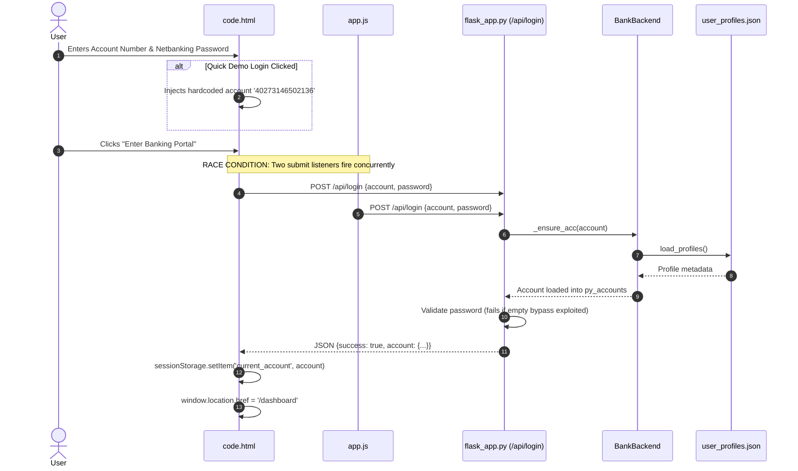
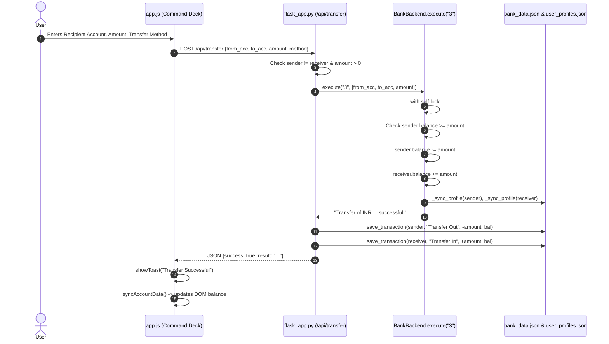
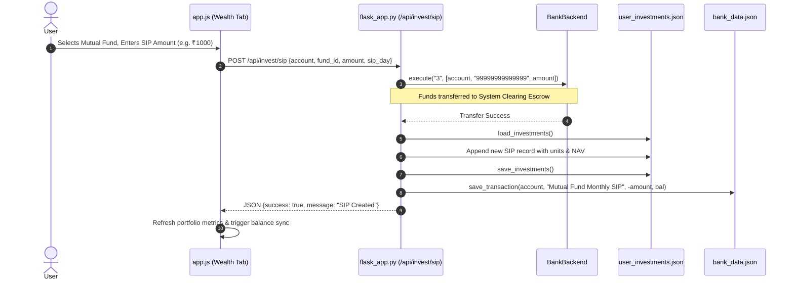

# CREDENCE CORE — DATA FLOW & SYNCHRONIZATION TOPOLOGY

**Document Classification:** Architectural Data Flow & State Specification  
**Project:** Credence Core — Institutional Digital Banking & Wealth Terminal  
**Audit Phase:** Phase 0 (Stabilization & Forensic Analysis)  
**Date:** 2026-10-31  
**Active Git Branch:** `stabilization/phase-0`  

---

## 1. End-to-End Data Flow Architecture

The data lifecycle within Credence Core traverses four discrete tiers: Browser Client Tier, Web API Controller Tier, In-Memory Ledger Tier, and File-Based Persistence Tier.

```mermaid
flowchart TD
    subgraph Browser ["Tier 1: Browser Client (DOM & State)"]
        UserAction["User Interaction (Click / Form Submit)"]
        SessionStorage["sessionStorage ('current_account')"]
        AppController["app.js Event Handler / State Controller"]
        DOMRender["DOM Elements Update / Toast Feedback"]
    end

    subgraph Controller ["Tier 2: Flask Web Controller (flask_app.py)"]
        RouteHandler["Flask Route Handler (@app.route)"]
        InputValidation["Regex / Sanity Validations"]
        BankBackendRef["bank (BankBackend Singleton)"]
    end

    subgraph Ledger ["Tier 3: Ledger Processing"]
        PyAccounts["self.py_accounts (In-Memory Map)"]
        ThreadingLock["with self.lock"]
        CppProcess["Native C++ Engine (bank_system.exe) [BYPASSED]"]
    end

    subgraph Persistence ["Tier 4: Persistence Stores (JSON Files)"]
        BankData["bank_data.json (Transactions)"]
        UserProfiles["user_profiles.json (KYC, Cards, Passwords)"]
        UserInvestments["user_investments.json (SIP, IPO, RD, Gold)"]
    end

    UserAction --> AppController
    SessionStorage -.->|Read current_account| AppController
    AppController -->|HTTP Fetch JSON| RouteHandler
    RouteHandler --> InputValidation
    InputValidation --> BankBackendRef
    BankBackendRef --> ThreadingLock
    ThreadingLock --> PyAccounts
    ThreadingLock -.->|Broken Stdin Pipe| CppProcess
    BankBackendRef -->|_sync_profile()| UserProfiles
    RouteHandler -->|save_transaction()| BankData
    RouteHandler -->|save_investments()| UserInvestments
    RouteHandler -->|JSON Response| AppController
    AppController --> DOMRender
```

---

## 2. Key Transactional Data Flows

### 2.1 User Login & Session Establishment Flow


### 2.2 Fund Transfer Flow (P2P & Utility Billdesk)


### 2.3 Wealth Investment Flow (SIP Booking)


---

## 3. Forensic Analysis: The Broken C++ IPC Bridge

The system documentation advertises a "Dual Execution Architecture" with a fast C++ core binary. Forensic analysis reveals why this bridge is inactive:

```text
flask_app.py Execution Path:
  Line 386: BankBackend.__init__()
    ↳ Line 472: self.start_process()
        ↳ Line 478: self.use_fallback = True  <-- Hardcoded unconditional fallback
        ↳ Line 479: self.proc = None          <-- C++ process is NEVER spawned
  Line 482: BankBackend.execute(choice, inputs)
    ↳ if not self.use_fallback and self.proc:
        ↳ run_cpp_command()  <-- Never reached!
    ↳ Pure Python fallback executed directly in flask_app.py:490-665
```

### Lethal Defects if C++ Execution Were Toggled On:
1. **Missing Method `_read_until`:**
   - In `run_cpp_command()` (`flask_app.py:96`): calls `bank_instance._read_until("Enter choice: ")`.
   - In `apply_cc()` (`flask_app.py:3145`): calls `bank._read_until("Enter choice: ")`.
   - `_read_until` is **nowhere defined** in `BankBackend` or any imported module. Toggling `self.use_fallback = False` causes an immediate `AttributeError: 'BankBackend' object has no attribute '_read_until'` on the first transaction.
2. **Missing Stream Handles:**
   - `run_cpp_command` and `apply_cc` access `bank_instance.stdin` and `bank.stdout`. `BankBackend` does not initialize these streams.
3. **No Process Lifespan Management:**
   - `start_process()` contains no `subprocess.Popen(['./bank_system'], ...)` call.

---

## 4. State Synchronization Anomalies & Race Conditions

### 4.1 Memory vs. Disk Divergence
Credence Core maintains duplicate state representations that frequently diverge:
1. **Balance in Memory (`self.py_accounts[acc]['balance']`):** Represented as a native Python `float`.
2. **Balance in Profile Store (`user_profiles.json`):** Represented as a formatted string with two decimal places (`"25500.00"`).
3. **Balance in Transaction Store (`bank_data.json`):** Recorded at transaction time in the last history element.
4. **Anomaly:** If a balance is modified via direct dictionary manipulation without calling `_sync_profile()`, `user_profiles.json` becomes stale. On server restart, `_ensure_acc()` re-reads from `user_profiles.json`, causing recent in-memory balance changes to be silently rolled back.

### 4.2 Non-Atomic Multi-File Persistence (Split-Brain Risk)
Financial operations frequently write to multiple uncoordinated files without transactional boundaries:
- A SIP investment updates:
  1. Primary account balance in `py_accounts`
  2. Escrow balance in `py_accounts`
  3. Profile state in `user_profiles.json` via `_sync_profile()`
  4. Investment records in `user_investments.json` via `save_investments()`
  5. Ledger entry in `bank_data.json` via `save_transaction()`
- If the server crashes or encounters an exception during step 4, the user's money is permanently deducted from balance, but the investment record is never created. No write-ahead log (WAL) or rollback mechanism exists.

### 4.3 Concurrent Write Clobbering
- `save_profiles()`, `save_investments()`, and `save_transaction()` write to temporary files and use `os.replace()`.
- While `os.replace` provides atomic filesystem replacement on Windows and POSIX, there is **no cross-process or file-level lock** (`portalocker` / `fcntl` / `LockFileEx`). Under multi-threaded or multi-worker Gunicorn environments (`render.yaml:6`, `Procfile:1`), worker processes overwrite each other's state without notice.

### 4.4 Serverless Ephemeral Data Destruction
- On Vercel serverless deployments (`vercel.json`), `IS_SERVERLESS` evaluates to `True` (`flask_app.py:20`), redirecting `DATA_DIR` to `/tmp`.
- Files written to `/tmp` in serverless execution environments are ephemeral and exist only during the lifetime of a single micro-container. When the micro-container is recycled or frozen, all customer balances, accounts, and investments reset to default hardcoded seed data.
