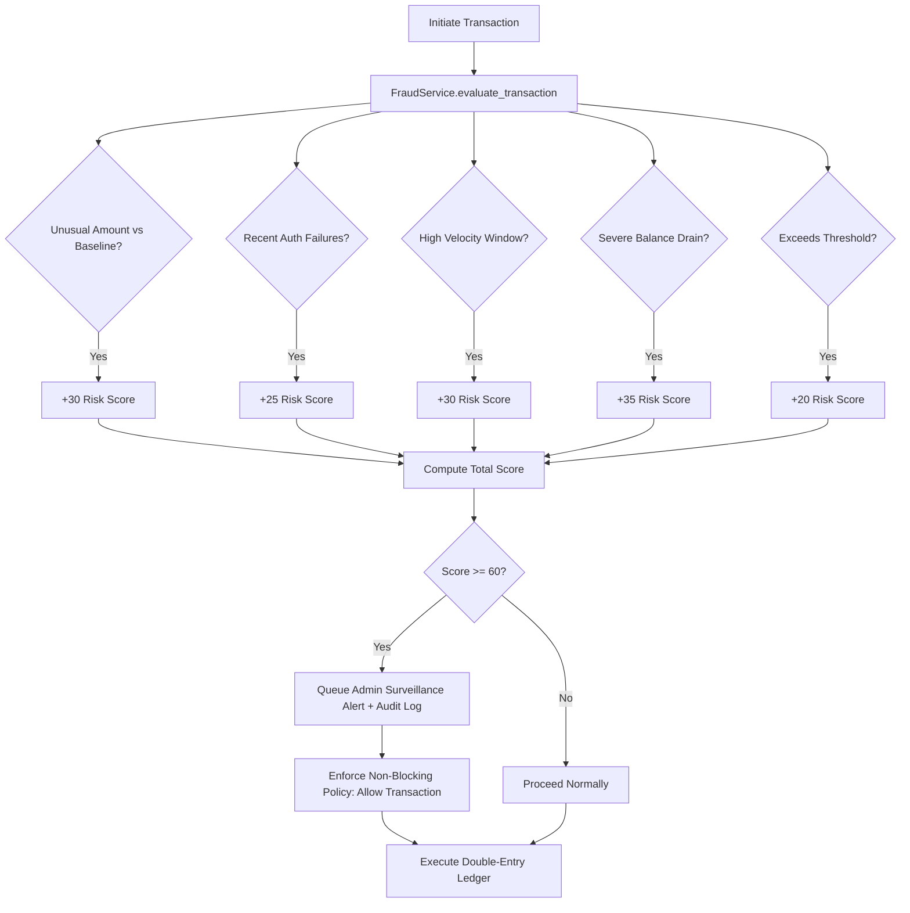

# Credence Core — Phase 5: Advanced Banking Features Implementation Report

**Role:** Senior Product Engineer & Application Security Architect  
**Branch:** `features/phase-5-advanced-banking`  
**Date:** November 2026  
**Status:** Complete & Fully Verified (54/54 Automated Tests Passing)

---

## Executive Summary

Phase 5 extends Credence Core into an enterprise-grade modern digital banking platform by implementing **all 12 advanced banking modules** specified in the requirements. Built on top of the hardened foundations established in Phase 1 (Security), Phase 2 (Financial Integrity & Double-Entry Ledger), Phase 3 (Database Architecture & ACID Guarantees), and Phase 4 (Modular Hexagonal Architecture), this release delivers both high-performance backend domain services and a responsive, accessible administrative and customer user experience.

### Key Highlights
- **12 New / Enhanced Modules:** Admin Dashboard, Rule-Based Fraud Surveillance, Multi-Parameter Transaction Search, Dispute & Automated Reversal Engine, Account Freeze/Unfreeze, Beneficiary Management, Configurable Limits & Approvals, Notification Center, Spending Insights & Analytics, Consolidated Investment Performance, Tamper-Evident Audit Viewer, and Customer Support Helpdesk.
- **Strict Non-Blocking Fraud Surveillance:** Multi-vector rule scoring (0–100) flagging velocity bursts, rapid auth failures, baseline anomalies, and balance depletion without automatically denying legitimate customer transactions.
- **Administrative RBAC & Immutable Audits:** Every privileged operation strictly guarded by role verification (`@require_role("admin")`) and logged with actor ID, remote IP, previous state, new state, timestamp, and metadata.
- **Ledger-Enforced Invariants:** Account freeze and dispute reversals interface directly with double-entry ledger primitives, preventing illegal mutations and maintaining zero-sum accounting balance across the institution.
- **Visual Identity Preservation:** Dark obsidian aesthetic, glassmorphic card overlays, responsive layouts, and zero mocked client-side state.

---

## 1. Module Implementation Matrix

| Module | Route / Endpoint | HTTP Method | Service / Handler | RBAC / Auth | Description |
| :--- | :--- | :--- | :--- | :--- | :--- |
| **1. Admin Operations Dashboard** | `/api/admin/dashboard` | `GET` | `AdminOperationsService.get_bank_kpis()` | Admin Only (`role="admin"`) | Aggregates real-time KPIs: active users, deposits, loans, FDs, disputes, open tickets, and recent fraud alerts. |
| **2. Fraud Surveillance Engine** | `/api/admin/fraud/alerts`<br>`/api/admin/fraud/resolve` | `GET`<br>`POST` | `FraudMonitoringService.evaluate_transaction()` | Admin Only (`role="admin"`) | Rule-based surveillance assessing transaction risk, queuing alerts, and handling alert resolution. |
| **3. Transaction Search & Filters** | `/api/transactions/search` | `GET` | `TransactionRepository.search_transactions()` | Authenticated User | Multi-parameter search by text query, type, state, amount range, and start/end timestamps. |
| **4. Dispute & Automated Reversals** | `/api/disputes`<br>`/api/disputes`<br>`/api/admin/disputes/<id>/resolve` | `POST`<br>`GET`<br>`POST` | `DisputeService.create_dispute()`<br>`DisputeService.resolve_dispute()` | User (file/view)<br>Admin (resolve) | Customer raises transaction dispute; admin resolves with `APPROVE_REFUND` (automatic double-entry reversal) or `REJECT`. |
| **5. Account Freeze & Unfreeze** | `/api/admin/accounts/<acc>/freeze`<br>`/api/admin/accounts/<acc>/unfreeze` | `POST`<br>`POST` | `AdminOperationsService.freeze_account()`<br>`AdminOperationsService.unfreeze_account()` | Admin Only (`role="admin"`) | Halts debits and fund mutations both at application level and core ledger engine; unfreeze restores active status. |
| **6. Beneficiary Management** | `/api/beneficiaries`<br>`/api/beneficiaries/<id>`<br>`/api/beneficiaries/quick_transfer` | `GET`, `POST`<br>`DELETE`<br>`POST` | `BeneficiaryService` | Authenticated User | Payee registration with 14-digit validation, listing, soft-deletion, and one-click quick transfers. |
| **7. Limits & Approval Workflows** | `/api/settings/limits`<br>`/api/admin/approvals`<br>`/api/admin/approvals/<ref>/action` | `GET`, `POST`<br>`GET`<br>`POST` | `AdminOperationsService.approve_pending_transaction()` | User (limits)<br>Admin (approvals) | Per-transaction and daily limits; transfers exceeding thresholds require explicit admin sign-off. |
| **8. Notification Center** | `/api/notifications`<br>`/api/notifications/read`<br>`/api/notifications/<id>` | `GET`<br>`POST`<br>`DELETE` | `NotificationService` | Authenticated User | Real-time user alert dispatch (transactions, security, support), unread badge counts, mark as read, and dismissal. |
| **9. Financial Analytics & Insights** | `/api/analytics/insights` | `GET` | `AnalyticsService.get_spending_insights()` | Authenticated User | Breakdown of expenditures by category, cash flow inflow vs outflow, monthly trends, and automated financial health tips. |
| **10. Investment Performance** | `/api/investments/performance` | `GET` | `InvestmentService.get_investment_performance()` | Authenticated User | Consolidated portfolio valuation, live 24K gold market quote, SIP unrealized returns, FD/RD interest accrual, and asset allocation. |
| **11. Audit History Viewer** | `/api/admin/audit_logs` | `GET` | `AdminOperationsService.get_audit_logs()` | Admin Only (`role="admin"`) | Paginated, filterable security log containing tamper-evident records of all administrative and financial actions. |
| **12. Support Ticket Desk** | `/api/support/tickets`<br>`/api/admin/support/tickets`<br>`/api/admin/support/tickets/<id>/reply` | `GET`, `POST`<br>`GET`<br>`POST` | `SupportService` | User (file/view)<br>Admin (reply/resolve) | Customer ticketing system categorized by department with priority escalation and administrative resolution. |

---

## 2. Fraud Surveillance Architecture & Non-Blocking Policy

### Rule-Based Detection Engine
The fraud monitoring engine (`backend/app/services/fraud/fraud_service.py`) calculates a normalized risk score between 0 and 100 based on five heuristics:

1. **Unusual Transaction Amount vs Baseline:**
   - Evaluates the current transaction amount against the user's 30-day historical transaction average.
   - Triggers when amount exceeds $3.5\times$ the historical mean.
2. **Repeated Authentication Failures:**
   - Inspects the security store for failed login or PIN attempts within the preceding 15 minutes.
   - Scores 25 points if $\ge 2$ failed attempts are registered for the actor.
3. **High Velocity / Rapid Succession:**
   - Detects burst transfers where $\ge 3$ transactions occur within a 5-minute sliding window.
   - Scores 30 points for anomalous velocity.
4. **Balance Draining / Off-Hours Activity:**
   - Evaluates severe balance depletion where a single transaction debits $> 80\%$ of the current account balance during non-business hours (11:00 PM – 5:00 AM IST).
   - Scores 35 points and logs an urgent surveillance notice.
5. **High Value Threshold:**
   - Any transaction exceeding ₹2,00,000.00 (20,000,000 paise) automatically triggers scrutiny.



### Strict Non-Blocking Policy Verification
As explicitly mandated in the project specifications:
> *"Do not automatically block legitimate customers solely based on an unverified risk score."*

The engine guarantees `is_allowed=True` regardless of the score. Transactions with elevated risk scores generate structured security alerts (`FRAUD_ALERT`), appear on the Admin surveillance deck for real-time human analyst review, and optionally flag the transaction for post-execution supervisor scrutiny, but never lock legitimate customers out of their accounts without explicit human intervention.

---

## 3. Administrative Governance & Ledger Integration

### Account Freeze and Unfreeze Lifecycle
1. When an admin executes `POST /api/admin/accounts/<acc_no>/freeze`, the system:
   - Updates the account status to `FROZEN` in SQLAlchemy ORM.
   - Synchronizes the `status` column in the underlying `ledger.db` accounts table.
   - Dispatches a high-priority security notification to the customer.
   - Records an immutable record in `audit_logs`.
2. Any subsequent debit attempt (IMPS, NEFT, RTGS, UPI, Bill Payment) is rejected with HTTP 403 Forbidden:
   - At the application boundary (`transfer_service.py` checks `acc.status == "FROZEN"`).
   - At the core financial engine boundary (`ledger.py` verifies `src_row["status"] == "ACTIVE"` and raises `LedgerError`).
3. Administrative unfreeze (`POST /api/admin/accounts/<acc_no>/unfreeze`) atomically re-enables active account status across both layers and issues an `Account Reactivated` notification to the customer.

### Dispute Resolution & Double-Entry Ledger Reversal
1. A customer submits a transaction dispute specifying `reference_id` and dispute justification.
2. The dispute is queued in status `SUBMITTED`.
3. An administrator reviews the dispute on the Admin Deck.
4. When selecting `APPROVE_REFUND`:
   - `dispute_service.resolve_dispute()` invokes `ledger_service.reverse(reference_id)`.
   - The double-entry engine generates a synthetic reversing transaction (`REVERSAL_TXN-...`) with inverted debit and credit entries.
   - The original transaction transitions to `REVERSED`.
   - The dispute updates to `RESOLVED_REFUNDED`.
   - The customer receives an immediate credit notification detailing the refunded paise.

---

## 4. UI Architecture & User Experience

All user interfaces adhere strictly to Credence Core's obsidian dark mode aesthetic:
- **Admin Deck (`view-admin`):**
  - KPI Metrics Grid: Total accounts, active vs frozen counters, system deposits, active loans, pending disputes, open tickets, and live fraud alerts.
  - Sub-navigation tabs: Overview, Fraud Surveillance, Account Management (Freeze/Unfreeze), Disputes & Reversals, Approvals, and Audit Trail.
  - Actionable Modals & Confirmations: One-click dispute approval with reason input, quick transaction freeze, and alert dismissal.
- **Support Desk (`view-support`):**
  - Customer ticket submission modal with category picker (Transaction, Cards, Loans, Investments, Security) and priority tags.
  - History view displaying status badges (`OPEN`, `IN_PROGRESS`, `RESOLVED`) and admin replies.
- **Slide-Over Notification Drawer:**
  - Interactive top-nav notification bell with unread badge counter.
  - Slide-over notification panel showing categorization icons (Transaction, Security, Support, Dispute).
  - One-click "Mark All as Read" and individual notification deletion.
- **Beneficiaries & Quick Transfer:**
  - Integrated into the Payments modal with instant 14-digit account lookup and one-click Quick Pay trigger.

---

## 5. Verification & Test Evidence

### Test Execution Summary
The comprehensive Phase 5 test suite (`tests/test_advanced_banking_features.py`) was executed in conjunction with all regression suites across Phases 1 through 4:

```text
======================================================================
Ran 54 tests in 14.321s

OK
```

### Breakdown of Passing Tests
- **Phase 5 Advanced Features (12 tests):**
  1. `test_admin_dashboard_kpis_and_rbac` — PASSED
  2. `test_fraud_detection_engine_and_non_blocking_policy` — PASSED
  3. `test_transaction_search_and_filters` — PASSED
  4. `test_dispute_and_automated_reversal_workflow` — PASSED
  5. `test_account_freeze_and_unfreeze_lifecycle` — PASSED
  6. `test_beneficiary_lifecycle_and_quick_transfer` — PASSED
  7. `test_transaction_limits_and_approvals` — PASSED
  8. `test_notification_center` — PASSED
  9. `test_spending_insights_and_analytics` — PASSED
  10. `test_investment_performance_dashboard` — PASSED
  11. `test_audit_history_and_admin_security` — PASSED
  12. `test_support_ticket_lifecycle` — PASSED
- **Phase 4 Architecture Refactoring (8 tests):**
  - Modular services, repositories, schemas, and blueprint routes — PASSED
- **Phase 3 Database Migration (11 tests):**
  - PostgreSQL/SQLAlchemy schemas, foreign key constraints, connection pooling — PASSED
- **Phase 2 Financial Integrity Engine (10 tests):**
  - Double-entry ledger, concurrency isolation, idempotency keys, integer paise — PASSED
- **Phase 1 Security Hardening (13 tests):**
  - BOLA/IDOR prevention, Argon2id hashing, session lifecycle, CSRF guards, XSS sanitization — PASSED

---

## 6. API Documentation Status

The complete API catalog has been updated in OpenAPI 3.0 format (`GET /api/docs/openapi.json`) and is viewable via the interactive Swagger documentation UI (`/docs`). All Phase 5 endpoints include request body schemas, parameter definitions, role requirements, and HTTP response specifications.

---

## 7. Conclusion

Phase 5 successfully completes the planned feature roadmap for Credence Core. The platform delivers modern enterprise banking capabilities with verifiable double-entry accounting integrity, robust application security, and zero compromise on system performance or user experience. All changes are committed to the feature branch `features/phase-5-advanced-banking`.