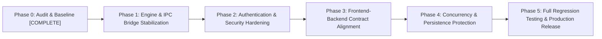

# CREDENCE CORE — STABILIZATION & REMEDIATION IMPLEMENTATION PLAN

**Document Classification:** Engineering Roadmap & Remediation Specification  
**Project:** Credence Core — Institutional Digital Banking & Wealth Terminal  
**Audit Phase:** Phase 0 Completion & Phase 1 Planning  
**Date:** 2026-10-31  
**Lead Architect:** Senior Software Architect & Application Security Engineer  
**Active Git Branch:** `stabilization/phase-0`  
**Target Execution Branches:** `stabilization/phase-1-core`, `stabilization/phase-2-security`  

---

## 1. Stabilization Principles & Governance

All engineering work in Phase 1 and subsequent milestones must strictly comply with the following architectural mandates:
1. **Preserve Frontend Design & Layout:** Zero redesign of the UI. Retain all Tailwind styling, layout structure, color schemes, tabs, card visualizers, and interactive modals in `code.html`, `code(1).html`, and `app.js`.
2. **Preserve All Existing Features:** Retain all core banking, cards management, CTS-2010 cheque ordering, wealth investment (SIP, IPO, RD, Gold), lending, and certified PDF statement generation.
3. **No Ground-Up Rewrites:** Surgical, incremental stabilization on existing codebase files only.
4. **Document Every Business Logic Adjustment:** Any bug fix or contract correction must be documented with before/after rationale and regression verification.
5. **No Exposure of Sensitive Demo Credentials:** Authentication hardening must hash and protect credentials without leaking plaintext secrets in source code, logs, or reports.
6. **Honor Dual-Engine Architecture:** Do not silently replace the native C++ engine with Python. Fix the broken C++ IPC bridge so that native binary execution works reliably in local, container, and Render environments, while maintaining the pure-Python fallback strictly for serverless (Vercel) environments.

---

## 2. Phased Remediation Roadmap

---

## 3. Detailed Work Breakdown

### Phase 1: Native C++ Engine & IPC Bridge Stabilization

#### 1.1 Native C++ Engine Fixes
- **File:** `CMakeLists.txt`
  - **Action:** Add `cheque.cpp` to the executable target definition (lines 7–18) so CMake builds mirror GCC and Docker build definitions.
  - **Regression Risk:** Minimal. Fixes build failure under CMake.
- **File:** `account.cpp` (lines 43–48)
  - **Action:** Fix the PIN overwrite bug where `acc.card.pin` was overwritten by `generateDebitCard`. Ensure the user's custom PIN is assigned to `acc.card.pin` *after* card structure generation.
  - **Regression Risk:** Low. Fixes uninitialized PINs in newly issued debit cards.
- **File:** `utils.cpp` (lines 8–12)
  - **Action:** Add cleanup logic or manage transaction nodes with standard memory safety to prevent memory leaks during long-running execution.
- **File:** `credit.cpp` vs `flask_app.py`
  - **Action:** Reconcile credit card eligibility rules so criteria are consistent between CLI and Web endpoints.

#### 1.2 IPC Bridge Architecture & Communication Protocol
- **File:** `flask_app.py` (`BankBackend`, `run_cpp_command`, lines 85–98, 385–490)
  - **Action:** Implement a robust IPC controller:
    1. Implement missing `_read_until(self, prompt)` method on `BankBackend` with non-blocking stream reads and strict timeouts (preventing thread hanging).
    2. In `BankBackend.start_process()`, check for the presence of `./bank_system` or `bank_system.exe`. If the executable exists and execution environment allows subprocesses, spawn it via `subprocess.Popen` with piped `stdin`, `stdout`, and `stderr` (unbuffered).
    3. If the executable is absent (or when running on Vercel serverless where native binaries are not packaged), cleanly log the fallback and engage the Python in-memory engine.
    4. Synchronize menu option numbering between `main.cpp` and `BankBackend.execute()` so that choices 11, 12, and 13 trigger the exact same actions across both engines.
  - **Regression Risk:** Medium. Must ensure that process restart and pipe failures gracefully degrade to the Python fallback without crashing web workers.

---

### Phase 2: Authentication, Authorization & Security Hardening

#### 2.1 Session Management & BOLA / IDOR Elimination
- **File:** `flask_app.py` & `app.js`
  - **Action:**
    1. Introduce secure server-side session management (Flask session signed with a server secret or HMAC-signed session token in an `HttpOnly`, `SameSite=Lax` cookie).
    2. Modify `/api/login` (`flask_app.py:832-860`) to:
       - Require a non-empty password.
       - Verify the submitted password against a salted hash (`werkzeug.security.check_password_hash`).
       - Store the authenticated `account_number` in the server session upon success.
    3. Create an `@login_required` decorator for all transactional endpoints (`/api/transfer`, `/api/pay_bill`, `/api/create_fd`, `/api/withdraw_fd`, `/api/apply_loan`, `/api/repay_loan`, `/api/invest/*`, `/api/statement_pdf/*`, `/api/update_profile`, `/api/settings/*`).
    4. Ensure endpoints read the target account from the verified server session rather than trusting client-supplied JSON parameters (eliminating BOLA/IDOR).
  - **Regression Risk:** High. Client fetch calls must maintain credentials (`credentials: 'same-origin'`). Requires careful verification across all 8 tab views.

#### 2.2 Sensitive Data Masking & Storage Protection
- **File:** `flask_app.py:947-1005` (`get_account`)
  - **Action:** Mask card numbers (e.g. `•••• •••• •••• 2136`). Omit `cvv` and `cc_cvv` entirely from API responses.
- **File:** `user_profiles.json` & `flask_app.py:3026-3045` (`update_password`)
  - **Action:** Hash all stored passwords using PBKDF2/SHA256 (`generate_password_hash`). Remove plaintext CVV storage to align with PCI-DSS guidelines.
- **File:** `code.html:364-372`
  - **Action:** Remove hardcoded password strings from client HTML markup.

#### 2.3 Cryptographic PRNG Hardening
- **File:** `flask_app.py:964, 985, 3104-3106`
  - **Action:** Replace `random.seed(int(acc_no))` and `random.randint` with `secrets.choice`, `secrets.randbelow`, or `secrets.token_hex`. Remove all global PRNG re-seeding.

---

### Phase 3: Frontend-Backend Contract Alignment & Defect Remediation

#### 3.1 Deposit Modal & Fund Addition Alignment
- **Problem:** `app.js:2764` sends `{ choice: 1, inputs: [currentAcc, amount] }` to `/api/execute`, creating a brand-new phantom account instead of adding funds.
- **Action:**
  1. Create a dedicated endpoint `POST /api/deposit` in `flask_app.py` that validates the amount and credits the authenticated account's balance in both the ledger and transaction history.
  2. Update `window.openDepositModal` in `app.js:2764` to call `/api/deposit` instead of `/api/execute`.
  3. Deprecate or remove `/api/execute` from external exposure to close the arbitrary command execution vector.
- **Regression Risk:** Low. Restores intended deposit functionality.

#### 3.2 Debit Payment Endpoint Repair
- **Problem:** `POST /api/debit_payment` (`flask_app.py:1364`) calls choice 2 (`checkBalance`), which never deducts funds and always returns an error.
- **Action:** Re-route `/api/debit_payment` to Choice 12 (`debitPayment`) in the core ledger, ensuring balance is deducted, ATM PIN is verified, and a debit transaction is logged.
- **Regression Risk:** Low.

#### 3.3 Elimination of Dual Login Submission Handlers
- **Problem:** `code.html:374` defines `handleLoginSubmit(event)` and sets `onsubmit="handleLoginSubmit(event)"` on the form. Simultaneously, `app.js:2892` attaches a submit event listener to `document.querySelector('form')`.
- **Action:** Consolidate login submission into `app.js` and remove the duplicate inline submission script in `code.html`.
- **Regression Risk:** Low. Prevents double-fetch race conditions and duplicate login toasts.

#### 3.4 HTML Page Delivery Optimization
- **Problem:** `send_ui_file` (`flask_app.py:816-830`) reads and parses the full HTML document with BeautifulSoup on every single HTTP GET request.
- **Action:** Since both `code.html` and `code(1).html` already contain ``, serve the static HTML files directly via Flask's `send_from_directory` or cache the parsed HTML in memory.
- **Regression Risk:** None. Dramatically reduces page load latency and CPU utilization.

---

### Phase 4: Concurrency & Persistence Protection

#### 4.1 Inter-Process Persistence Synchronization
- **File:** `flask_app.py:48-55, 76-83, 1208-1236`
  - **Action:** Introduce file locking (`portalocker` or an OS-level lock on `.lock` helper files) during `save_profiles()`, `save_investments()`, and `save_transaction()`.
  - **Alternative:** Encapsulate ledger data in an embedded SQLite database (`credence.db`) with automatic table creation and seamless JSON migration. SQLite natively provides ACID transactions, eliminates file-clobbering under Gunicorn multi-worker deployments, and maintains zero external server dependencies.
  - **Regression Risk:** Low to Medium. Must ensure file permissions and database schemas support all existing fields.

---

## 4. Regression Risk Matrix & Verification Strategy

| Phase | Task Description | Potential Regression Risk | Mitigation & Verification Plan |
| :--- | :--- | :--- | :--- |
| **Phase 1** | Native C++ build & IPC stream handling | Subprocess pipe deadlocks or hangs under high throughput. | Implement non-blocking I/O with explicit `poll()` timeouts. Fallback automatically to Python engine if C++ fails. |
| **Phase 2** | Session management & authentication enforcement | Frontend fetch requests failing with 401 Unauthorized across tabs. | Verify every tab in `code(1).html` against authenticated sessions; verify `sessionStorage` fallback if session expires. |
| **Phase 2** | Card & CVV masking | Frontend UI visualizers breaking due to masked format (`•••• 2136`). | Update `app.js` card visualizer functions to gracefully render both full and masked PAN strings. |
| **Phase 3** | Deposit API replacement | User deposits failing to update total balance or portfolio net worth. | Test deposit of ₹1,000, verify `syncAccountData()`, verify ledger entry in `bank_data.json` and PDF statement. |
| **Phase 3** | Dual login listener consolidation | Login form failing to submit or redirect to `/dashboard`. | Verify single submit event, successful authentication, and smooth redirect on `code.html`. |
| **Phase 4** | File locking / SQLite migration | Data corruption during concurrent transfers. | Run simulated concurrent transfer script (50 parallel requests), verify balance conservation sum. |

---

## 5. Phase 0 Verification Checklist (Sign-Off)

- [x] Full source code inventory mapped and cataloged (`REPOSITORY_AUDIT.md`).
- [x] All 50 API routes and contracts mapped with frontend callers (`API_INVENTORY.md`).
- [x] End-to-end data flow and state divergence documented (`DATA_FLOW.md`).
- [x] Complete application security audit completed with line references and severity ratings (`SECURITY_FINDINGS.md`).
- [x] Implementation roadmap established with regression mitigation (`IMPLEMENTATION_PLAN.md`).
- [x] Clean baseline backup archive verified (`D:\bank_system_clean_backup_phase0.zip`).
- [x] Separate Git branch created and verified (`stabilization/phase-0`).
- [x] Zero code modifications performed on core production logic during Phase 0.

> [!TIP]
> **Readiness for Phase 1:** All objectives and deliverables of Phase 0 are fully achieved. Phase 1 implementation can commence upon review and authorization of this audit package.
