# CREDENCE CORE — REPOSITORY AUDIT & ARCHITECTURAL BASELINE

**Document Classification:** Internal Technical Audit & Architecture Baseline  
**Project:** Credence Core — Institutional Digital Banking & Wealth Terminal  
**Audit Phase:** Phase 0 (Stabilization & Forensic Analysis)  
**Date:** 2026-10-31  
**Auditor:** Senior Software Architect & Application Security Engineer  
**Active Git Branch:** `stabilization/phase-0`  
**Baseline Backup Archive:** `D:\bank_system_clean_backup_phase0.zip` (SHA-256 Verified, 1,528,257 bytes)

---

## 1. Executive Summary

A comprehensive architectural and forensic source code analysis was conducted on the complete Credence Core codebase prior to any production code modifications. The repository consists of a hybrid multi-language stack comprising:
- **C++20 Native Engine:** Command-line terminal banking ledger.
- **Python 3 / Flask Backend:** REST API controller, WSGI middleware, PDF statement generation, and in-memory ledger simulation.
- **Modern Vanilla JavaScript & HTML5 / Tailwind CSS Frontend:** Single-page dual-file banking command deck (`code.html` landing/auth portal and `code(1).html` 8-tab institutional command deck driven by `app.js`).
- **File-Based JSON Persistence Stores:** `bank_data.json`, `user_profiles.json`, and `user_investments.json`.
- **Cross-Platform Deployment Harnesses:** Docker containerization, Render.com web service configuration, Vercel serverless functions, and local Windows batch launcher.

### Key Audit Findings & Architectural State
1. **Engine Decoupling / Disjointed IPC:** While marketing documentation and build scripts proclaim a C++ core engine backing the application, the Flask middleware (`flask_app.py:478`) hardcodes `self.use_fallback = True` and never spawns `bank_system.exe`. All transactions are executed against an un-synchronized Python in-memory ledger.
2. **Missing C++ IPC Implementation:** Critical IPC routines in `flask_app.py` call `bank._read_until()`, which does not exist anywhere in the codebase. If the C++ process execution were toggled on, the application would terminate immediately with an `AttributeError`.
3. **Deadly Frontend-to-Backend Mappings:** 
   - When a user attempts to deposit funds via `window.openDepositModal` (`app.js:2767`), the frontend sends `{ choice: 1 }` to `/api/execute`. Choice 1 executes **Account Creation**, creating an unintended phantom account instead of crediting funds.
   - The `/api/debit_payment` endpoint (`flask_app.py:1392`) calls Choice 2 (`checkBalance`), which never deducts funds and always returns an error.
4. **Severe Security & Authentication Deficits:** Zero session management, missing authentication on all transactional APIs (BOLA/IDOR), plaintext password and PIN storage, unauthenticated exposure of full debit and credit card numbers along with CVVs via `/api/account/<acc_no>`, and deterministic seeding of Python's PRNG.
5. **Dual-Listener Race Conditions:** `code.html` attaches an inline DOM submission handler (`handleLoginSubmit`) while `app.js` attaches a secondary submit event listener to the same form, triggering duplicate concurrent network calls.

---

## 2. Complete File Inventory & Dependency Mapping

### 2.1 Workspace Root Inventory

| File Path | Size (Bytes) | Lines | Purpose / Description | Primary Dependencies |
| :--- | :--- | :--- | :--- | :--- |
| `CMakeLists.txt` | 332 | 18 | CMake build definition for native C++ binary | CMake 3.20+, C++20 |
| `bank.h` | 1,828 | 86 | Header definitions, structs (`Account`, `DebitCard`, etc.), externs | `<string>`, `<unordered_map>`, `<vector>` |
| `main.cpp` | 1,779 | 57 | CLI menu loop for standalone C++ console operations | `bank.h`, `<iostream>` |
| `account.cpp` | 3,203 | 109 | Account creation, balance check, intra-bank transfer logic | `bank.h`, `<random>`, `<algorithm>` |
| `credit.cpp` | 2,028 | 66 | Credit card eligibility verification and application logic | `bank.h`, `<iostream>` |
| `debit.cpp` | 1,147 | 46 | Debit card payment processing and PIN check | `bank.h`, `<iostream>` |
| `fd.cpp` | 1,711 | 71 | Fixed deposit booking, withdrawal, and maturity calculation | `bank.h`, `<iostream>` |
| `loan.cpp` | 1,272 | 53 | Loan application and loan repayment routines | `bank.h`, `<iostream>` |
| `upi.cpp` | 1,427 | 59 | UPI ID creation and peer-to-peer UPI transfer routines | `bank.h`, `<iostream>` |
| `cheque.cpp` | 687 | 28 | Cheque book ordering and leaf numbering | `bank.h`, `<iostream>` |
| `report.cpp` | 677 | 21 | Formatted console dump of all accounts in memory | `bank.h`, `<iomanip>` |
| `utils.cpp` | 2,993 | 92 | Linked-list transaction logging, binary search, debit card generator, system escrow | `bank.h`, `<algorithm>`, `<sstream>` |
| `globals.cpp` | 301 | 11 | Instantiation of global maps (`accounts`, `upiMap`, `sortedAccountNumbers`) | `bank.h` |
| `bank_system.exe` | 379,255 | Binary | Precompiled Windows x64 binary of the C++ engine | MSVCRT / MinGW runtime |
| `flask_app.py` | 133,878 | 3,229 | Core Web Backend: Flask REST API, PDF generation, in-memory ledger | `flask`, `beautifulsoup4`, `reportlab` |
| `api/index.py` | 1,550 | 41 | Vercel WSGI entry point and URL path rewriting middleware | `flask_app.py`, `urllib.parse` |
| `app.js` | 154,132 | 2,938 | Complete client-side UI controller, state sync, modals, charts, event listeners | Vanilla DOM, Tailwind CSS |
| `code.html` | 18,213 | 400 | Landing page, netbanking login, and account registration UI | Tailwind CDN, Material Symbols |
| `code(1).html` | 85,359 | 1,720 | 8-Tab Unified Banking Command Deck and institutional dashboards | Tailwind CDN, Material Symbols |
| `bank_data.json` | 2,243 | JSON | Ledger history of system and customer transactions | JSON file storage |
| `user_profiles.json` | 697 | JSON | User profiles, passwords, card details, limits, and preferences | JSON file storage |
| `user_investments.json` | 2,320 | JSON | Portfolio state: active SIPs, IPO bids, RD schedules, Gold vault | JSON file storage |
| `run_html_ui.bat` | 1,384 | 48 | Windows launcher script (environment check + pip + launch) | cmd.exe, Python, g++ |
| `Dockerfile` | 631 | 28 | Container buildfile compiling C++ engine and launching Flask | `python:3.11-slim`, `g++`, `gunicorn` |
| `render.yaml` | 354 | 9 | Render.com Web Service blueprint configuration | Render build environment |
| `Procfile` | 28 | 1 | Gunicorn production WSGI process definition | `gunicorn` |
| `vercel.json` | 105 | 8 | Vercel Serverless rewrite routing all paths to `/api/index` | Vercel Serverless Gateway |
| `requirements.txt` | 40 | 4 | Declared Python dependencies | `pip` |
| `README.md` | 8,559 | 152 | Project documentation and deployment instructions | Markdown |
| `.gitignore` | 395 | 35 | Git ignore rules | Git |

---

## 3. Technology Stack & Runtime Dependencies

```mermaid
graph TD
    subgraph Client [Frontend Tier: Browser]
        UI1["code.html (Landing/Auth)"]
        UI2["code(1).html (Command Deck)"]
        JS["app.js (Controller & State Sync)"]
        Tailwind["Tailwind CSS CDN"]
        Font["Google Fonts (Plus Jakarta Sans, JetBrains Mono)"]
    end

    subgraph Server [Backend Tier: Python 3.11 / Flask]
        WSGI["Gunicorn / Vercel WSGI (api/index.py)"]
        Flask["flask_app.py (REST Controller)"]
        PDF["ReportLab PDF Generator"]
        BS4["BeautifulSoup4 HTML Injector"]
        PyLedger["BankBackend (In-Memory Python Store)"]
    end

    subgraph Native [Core Ledger Engine: C++20]
        CPP["bank_system.exe / bank_system (Binary)"]
        CPPLedger["Account / Transaction Linked List"]
    end

    subgraph Storage [Data Tier: Local JSON Files]
        JSON1["bank_data.json"]
        JSON2["user_profiles.json"]
        JSON3["user_investments.json"]
    end

    UI1 -->|HTTP REST Fetch| Flask
    UI2 -->|HTTP REST Fetch| Flask
    JS -->|HTTP REST Fetch| Flask
    WSGI --> Flask
    Flask --> PDF
    Flask --> BS4
    Flask -.->|Broken Stdin/Stdout IPC| CPP
    Flask --> PyLedger
    Flask --> JSON1
    Flask --> JSON2
    Flask --> JSON3
```

### 3.1 Runtime Dependency Matrix
1. **Python Dependencies (`requirements.txt`):**
   - `flask`: HTTP routing, request parsing, response serialization.
   - `beautifulsoup4`: HTML DOM parsing during page serving (`send_ui_file`).
   - `reportlab`: Generation of certified institutional bank statement PDFs.
   - `gunicorn`: Production WSGI HTTP server for Render and Docker.
2. **Native Toolchain:**
   - MinGW-w64 / GCC `g++` with C++20 standard support (`-std=c++20`).
   - CMake 3.20+ (Build definition).
3. **Frontend CDN Dependencies:**
   - Tailwind CSS Play CDN: `https://cdn.tailwindcss.com`
   - Google Fonts: `Plus Jakarta Sans`, `Inter`, `JetBrains Mono`
   - Google Material Symbols Outlined: `https://fonts.googleapis.com/css2?family=Material+Symbols+Outlined`

---

## 4. Architectural Analysis & Component Breakdown

### 4.1 Native C++ Engine (`bank.h`, `main.cpp`, `*.cpp`)
The native engine is designed as an interactive CLI application running on a continuous `while (true)` loop with numeric choices 1 through 14:
- In-memory data structures: `std::unordered_map<long long, Account> accounts`, `std::vector<long long> sortedAccountNumbers`, `std::unordered_map<std::string, long long> upiMap`.
- Linked-list transaction history using raw pointers (`Transaction* history`).
- **Defect in `CMakeLists.txt`:** Lines 7–18 omit `cheque.cpp`. Compiling with CMake results in an unresolved symbol error for `orderCheque()`.
- **Memory Leak in `utils.cpp:9`:** `new Transaction{type, amount, acc.history}` is never deleted. No destructor or container deallocation routine exists.
- **PIN Overwrite Bug in `account.cpp:45-46`:** When issuing a debit card, the user enters a PIN into `acc.card.pin`, but the very next line executes `acc.card = generateDebitCard(acc.name);`, which returns a newly created struct where `pin` is uninitialized or overwritten.
- **Insecure PRNG in `utils.cpp:32, 41, 45`:** Card numbers, CVVs, and expiry dates are generated using standard `rand()` without `srand()` seeding, resulting in fixed deterministic sequences across executions.

### 4.2 Python Flask Backend (`flask_app.py`)
`flask_app.py` acts as a monolithic server combining routing, business logic, static data, and persistence:
- **IPC Architecture Flaw:** Lines 85–98 define `run_cpp_command(bank_instance, choice, inputs)`. However, `BankBackend.__init__` (lines 386–393) sets `self.use_fallback = True` and `self.proc = None`. Lines 472–480 do not invoke `subprocess.Popen`. Furthermore, `_read_until` is referenced at line 96 and line 3145 but is never defined. The C++ engine is entirely bypassed in practice.
- **Duplicated Ledger Implementation:** Lines 481–665 reimplement the banking ledger in Python within `BankBackend.execute`. This implementation does not match C++ behavior (e.g., choice 11 in Python is an account transfer, whereas choice 11 in C++ is UPI payment).
- **Redundant BeautifulSoup Processing:** `send_ui_file` (lines 816–830) reads `code.html` or `code(1).html` from disk, constructs a complete BeautifulSoup DOM tree, checks for `<script src="/app.js">`, and converts it back to a string on every request. Both HTML files already contain this script tag on disk.
- **Serverless Ephemeral Storage Disconnect:** Lines 20–21 switch `DATA_DIR` to `/tmp` when running under Vercel or AWS Lambda. Under serverless execution, writes to `/tmp` are ephemeral and lost when lambda instances freeze or recycle.

### 4.3 Frontend Command Deck (`app.js`, `code.html`, `code(1).html`)
- **`code.html` (Landing & Authentication):** Houses the marketing presentation, quick demo login helper, and login form. It contains inline JavaScript (lines 364–400) that directly manipulates DOM inputs and fires `/api/login`.
- **`code(1).html` (Unified Command Deck):** Houses the 8 primary operational tab views (`view-dashboard`, `view-loans`, `view-invest`, `view-transfer`, `view-transactions`, `view-analytics`, `view-reports`, `view-settings`).
- **`app.js`:** Orchestrates all client interaction: tab switching, dynamic modal generation (`openModal`), live gold price polling, SIP/IPO/RD/Gold calculations, card toggle actions, and periodic synchronization (`syncAccountData`).
- **State Synchronization:** The frontend relies on `sessionStorage.getItem('current_account')` to determine the active account number. Every view refresh fetches `/api/account/<acc_no>` and updates the DOM.

---

## 5. Duplicate Business Logic & Implementation Conflicts

The table below catalogs all duplicate and conflicting business logic implementations between the C++ engine and the Python backend:

| Capability | Native C++ Implementation | Python Backend Implementation | Conflict / Regression Risk |
| :--- | :--- | :--- | :--- |
| **Account Creation** | `account.cpp:20-64` `generateUniqueAccountNumber()` using `mt19937_64` | `flask_app.py:500-527` `flask_app.py:862-945` Python `random.randint` | High: Account numbers generated in Python are not validated against C++ state. Python generates profile metadata (PAN, employment, CIF) unknown to C++. |
| **Deposit Processing** | Initial deposit only (`account.cpp:31-33`). No subsequent deposit function. | `flask_app.py:493-527` No standalone deposit API exists. | Critical: Frontend `openDepositModal` (`app.js:2767`) calls choice 1 (creates duplicate new account rather than depositing into current account). |
| **Debit Card Payment** | `debit.cpp:5-46` Choice 12: checks PIN, deducts balance, logs transaction. | `flask_app.py:1364-1405` `/api/debit_payment` calls choice 2 (`checkBalance`). | Critical: Debit card payments through the web API fail unconditionally with system declined error. |
| **Fixed Deposit Maturity** | `fd.cpp:53-71` Calculates 5.0% simple interest (`amount * 1.05`). | `flask_app.py:590-596` Calculates 7.2% - 7.8% compounded annual APY. | Medium: Divergence in projection numbers between CLI and Web API. |
| **Credit Card Eligibility** | `credit.cpp:6-41` Age: 18-70, Income: ₹1,00,000, CIBIL: 750, Resident: Indian. | `flask_app.py:3102` Age: >=21, Income: ₹25,000, CIBIL: 700. | High: Different qualification rules between native engine and REST API. |
| **Menu Choice Mapping** | `main.cpp:29-55` 11: `payUPI` 12: `debitPayment` 13: `applyCreditCard` | `flask_app.py:640-664` 11: Intra-bank transfer 12: Issue Cheque 13: Not handled in `execute()` | Critical: Choice numbers in `BankBackend.execute` diverge completely from `main.cpp` for choices 11, 12, and 13. |
| **Wealth & Capital Markets** | Not implemented (Zero support for SIP, IPO, RD, Gold). | Implemented exclusively in Python (`flask_app.py:1490-2718`). | Medium: C++ engine is incapable of tracking investment portfolios without structural schema extension. |

---

## 6. Verification of Baseline Functionality

To establish an immutable verification baseline before Phase 1 code alterations:
1. **Local Repository State:** Clean git working tree verified on branch `stabilization/phase-0`.
2. **Backup Archive:** Full directory backup created at `D:\bank_system_clean_backup_phase0.zip`.
3. **Existing Demo Accounts:**
   - System Escrow Clearing Account: `99999999999999` (Balance: ₹1,000,000,000.00).
   - Primary Demo User Account: `40273146502136` (Name: "Ben Tennyson", Balance: ₹25,500.00, Loan: ₹6,000.00, FD: ₹3,000.00).
4. **All mandatory stabilization constraints verified:**
   - Repository untouched on `main`.
   - Separate feature branch active.
   - Zero structural rewrites or deletions initiated.
